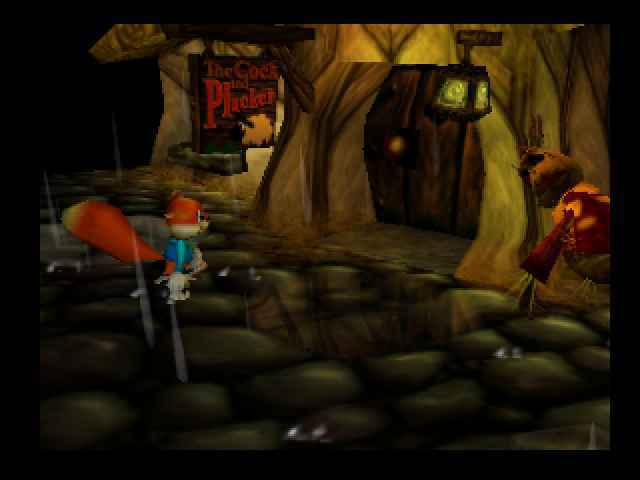
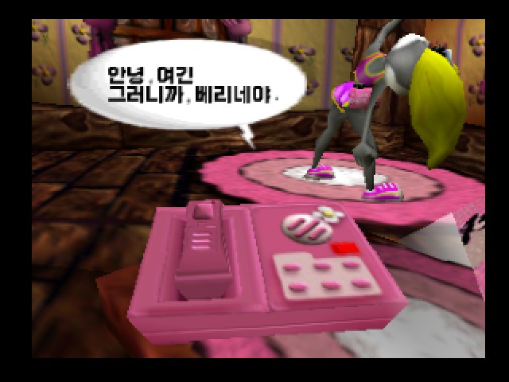
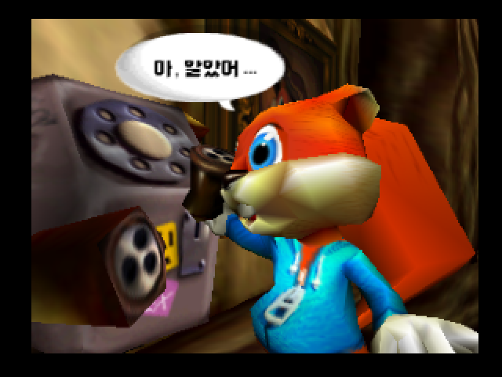
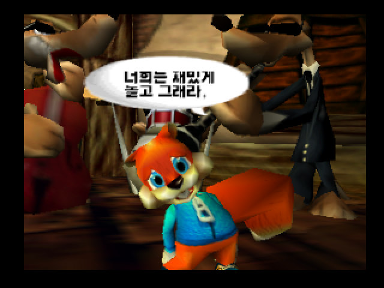
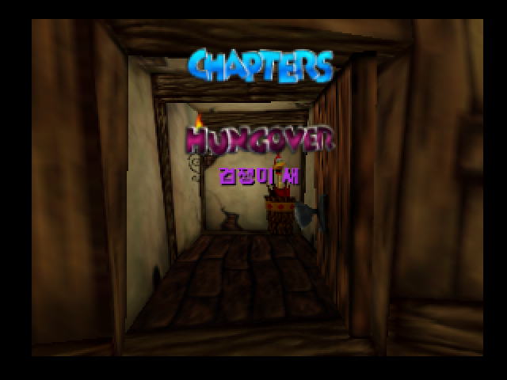
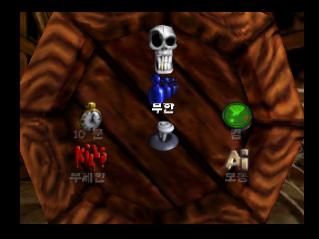

# 컨커스 배드 퍼 데이 (N64) 비공식 한글패치

닌텐도64 북미판 **Conker's Bad Fur Day (컨커스 배드 퍼 데이, 2001)** 비공식 한국어 패치입니다. 이 저장소에는 제작 도구와 기술 문서만 있고, 패치 파일(xdelta)은 [Releases](../../releases)에서 받을 수 있습니다. 게임 원본·영어 원문·번역 대본은 포함하지 않습니다.

## 적용 방법
1. 아래 해시와 일치하는 **원본 `Conker's Bad Fur Day (USA).z64`** (빅 엔디언 .z64 형식)를 준비합니다.
   - PowerShell: `Get-FileHash -Algorithm MD5 -LiteralPath ".\Conker's Bad Fur Day (USA).z64"`
   - .n64/.v64 형식이라면 먼저 Tool64 등으로 .z64(빅 엔디언)로 바꿉니다.
2. xdeltaUI 같은 도구로 원본 `.z64` 에 `Conker_BFD_KO_v1.0.xdelta` 를 적용합니다. (Patch = xdelta, Source File = 원본 ROM, Output File = 새 파일명)
   - 명령줄: `xdelta3 -d -s "Conker's Bad Fur Day (USA).z64" Conker_BFD_KO_v1.0.xdelta "Conker's Bad Fur Day (Korean).z64"`
3. 만들어진 `.z64` 를 **확장팩(Expansion Pak, 8MB RAM)을 켠** 에뮬레이터에서 실행합니다. (BizHawk 2.11.1에서 확인)

| 항목 | 값 |
| --- | --- |
| 원본 ROM 크기 | 67,108,864 바이트 |
| 원본 ROM CRC32 | `ce8cc172` |
| 원본 ROM MD5 | `00e2920665f2329b95797a7eaabc2390` |
| 원본 ROM SHA-256 | `32e6a8b970ec12ac5f782344945aa0c98a193832eefb687529d03bab6948714b` |
| xdelta SHA-256 | `bbc462826079125ee510520fe531bd8cac3192724d2a66371944e380b06af3b6` |
| 결과 ROM 크기 | 67,108,864 바이트 |
| 결과 ROM SHA-256 | `1854c7e2a80997e69f003812742ee6dd92d6beb603805466a419d862932baf58` |

## 주의
- **확장팩(8MB) 필수**입니다. 한글 글꼴을 확장 메모리(0x80401000)에 올려 쓰므로, 4MB 설정에서는 글자가 나오지 않거나 멈출 수 있습니다.
- 원본에서 만든 **상태저장(세이브 스테이트)** 은 쓰지 마세요. 게임 내 세이브(EEPROM)는 그대로 쓸 수 있습니다.
- 실기·플래시 카트리지에서는 동작을 확인하지 않았습니다.
- xdelta는 압축하지 않은 형식(`-0`)입니다(약 430KB).

## 한글화 내용
- 컷신·게임 중 말풍선 대사 전체(861줄 + 누락 보충 12줄) 직접 번역 — 삐 처리 기호·버튼 아이콘·색 코드 유지
- 챕터 이름, 일시정지·챕터 메뉴 문구, 타이틀 안내(성인 전용·진동팩 안내), 멀티플레이 설정(규칙·AI 수준·팀·게임 모드·통계)·사운드 옵션 문구, 스태프롤 역할명
- 한글 838자를 2바이트 부호로 추가, 글자 매핑·폭 계산·그리기 함수 세 곳에 후크
- 글꼴: 갈무리11 Bold (원래 글꼴과 같은 12×12 크기)

## 그대로 둔 것
- 메인 메뉴 제목(GAME1·MULTI·OPTIONS·CHAPTERS), PAUSED·NEW GAME 등 **그림 텍스처 글자**, 타이틀 로고
- 스태프롤 인명·법적 고지, 치트 입력 글자판과 비속어 필터 단어 목록(입력 비교용 데이터라 바꾸면 치트가 깨짐)
- 음성(영어)

## 검증 범위
BizHawk 2.11.1(확장팩 사용)에서 타이틀·메인 메뉴·멀티 메뉴(설정 화면·대전)·옵션·치트·챕터 메뉴와, 새 게임 오프닝 컷신부터 숙취(Hungover) 챕터 조작 시작까지 직접 확인했습니다. 대사 파일 전체는 정적 검사로 영어가 남지 않은 것을 확인했지만, 그 이후 챕터의 대사와 첫 B 패드 힌트는 화면으로 보지 못했습니다. 전체 플레이 검증은 하지 않았습니다. 문제를 발견하면 Issues에 알려 주세요.

## 스크린샷
| | |
| --- | --- |
|  |  |
|  |  |
|  |  |

## 문서
- [CHANGELOG.md](CHANGELOG.md) — 변경 기록
- [docs/TECHNICAL.md](docs/TECHNICAL.md) — ROM 구조와 한글화 방법
- [docs/BUILD.md](docs/BUILD.md) — 직접 빌드하는 방법
- [docs/FONT_CREDITS.md](docs/FONT_CREDITS.md) — 글꼴
- [RIGHTS.md](RIGHTS.md) — 권리 및 외부 자료
